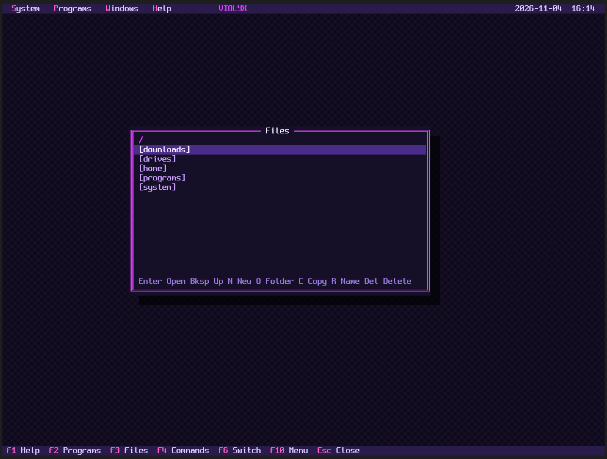
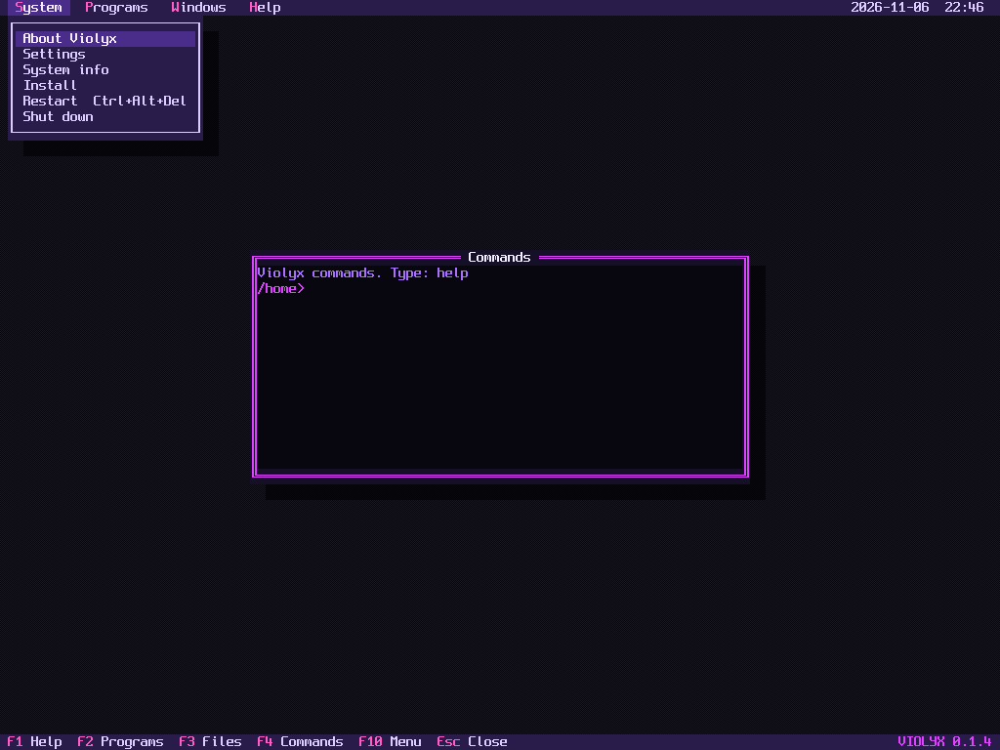
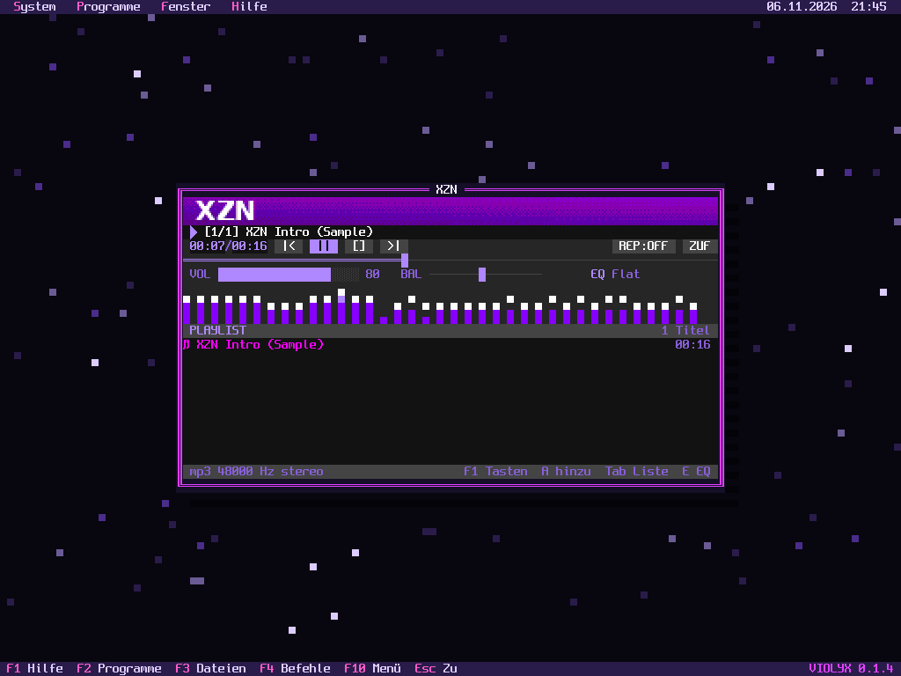
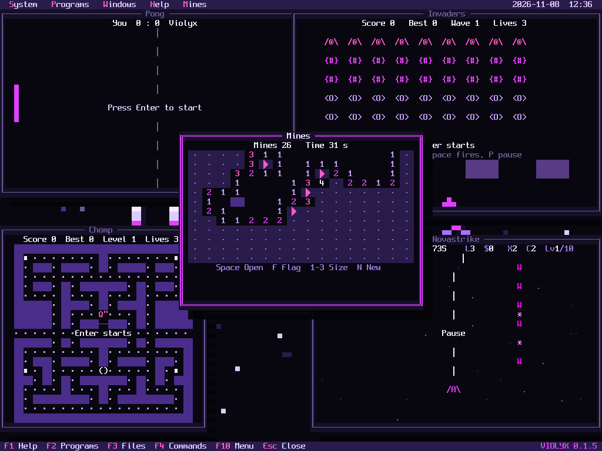
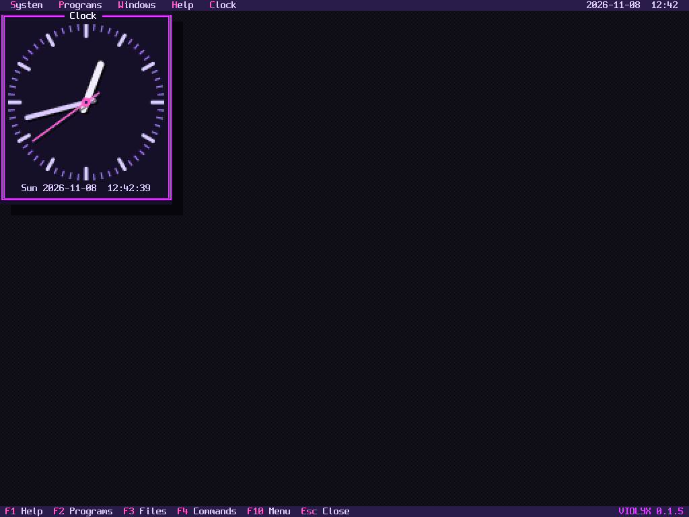
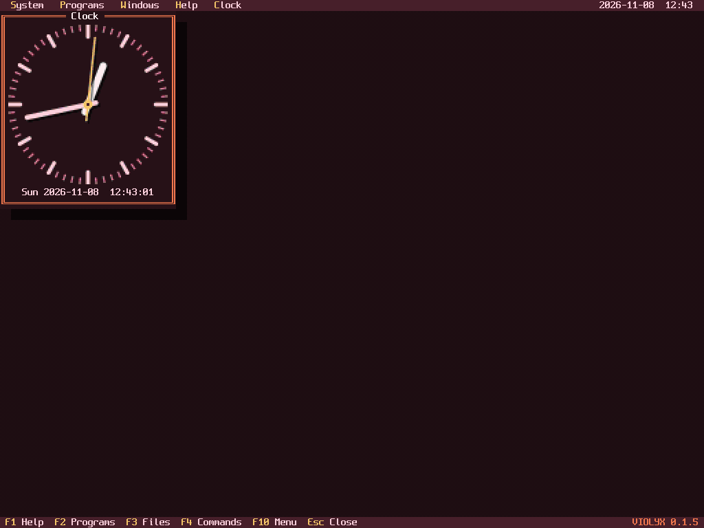
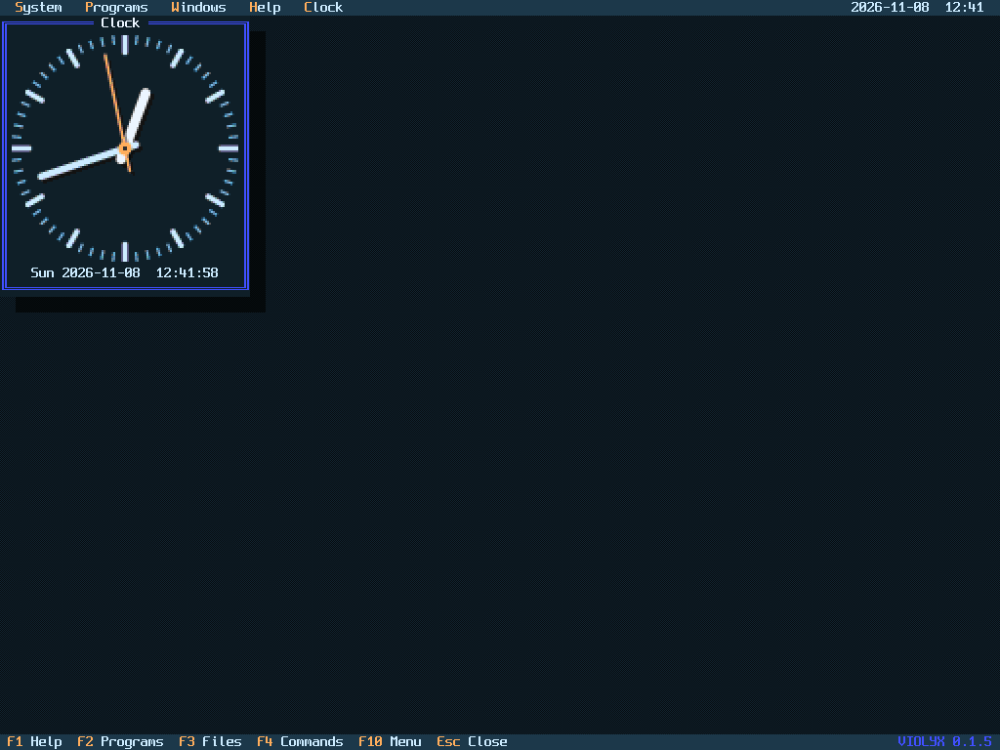
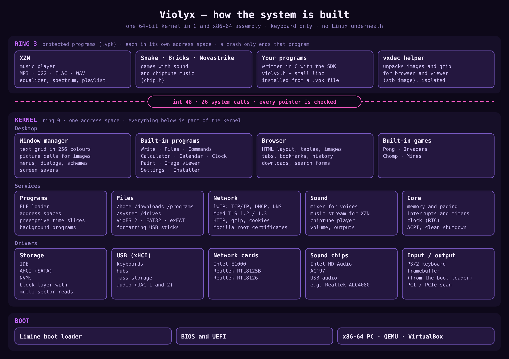

# Violyx

**A keyboard-only 64-bit operating system for x86 PCs, with a retro text desktop in glowing violet.**

Violyx is written from scratch: its own kernel, drivers, file system, windowed text
desktop and programs. There is no Linux underneath. It boots on BIOS and UEFI, connects
to the internet, browses the web, plays music and games, all without ever touching a mouse.

This project was created with the help of AI. It is written in C and x86-64 assembly (NASM), with Python used for the build and test tools.


| | |
|---|---|
|  |  |
|  |  |
|  |  |

| | | |
|---|---|---|
|  |  |  |

> **Status: Experimental hobby project (version 0.1.5).** Tested in QEMU, VirtualBox, and on actual hardware (via USB flash drive), including wired internet and USB sound.
> Installed programs run in protected memory, but the system itself does not, so please do not enter
> passwords or use it for anything sensitive. See [Limitations](#limitations).

## Features

- **Keyboard-only desktop** with overlapping windows, menus and dialogs, in 256 colours
- **Web browser** with HTTPS, certificate checks, images, tabs, bookmarks, history, search on the page, cookies, gzip, downloads and search forms
- **Programs:** Write, Files, Commands, Calculator, Calendar, Clock, Paint, Image viewer, XZN, Settings
- **XZN:** the Violyx edition of the Xenon-Zones (XZN) music player, for MP3, OGG, FLAC and WAV
- **Games:** Pong, Invaders, Chomp, Mines, Snake, Bricks and Novastrike, with sound and music
- **Sound:** Intel HD Audio, AC'97 and USB audio, including mainboard chips such as the Realtek ALC4080
- **Colour schemes:** Violet, Ocean, Emerald, Amber, Ruby and Graphite, for everyone who prefers another colour
- **Screen savers:** the Violyx logo with twinkling stars, 3D wire frames, a seven-segment clock, the analog clock and a synthwave sunset
- **Backgrounds:** patterns, the Violyx logo and your own images, drawn in Paint
- **Installable programs:** `.vpk` packages that run in protected memory, with an SDK in C
- **Networking:** Intel E1000 and Realtek RTL8125B/RTL8126 drivers, DHCP, DNS, ping, TCP/IP via lwIP
- **HTTPS:** TLS 1.2 and 1.3 via Mbed TLS with Mozilla root certificates
- **Storage:** IDE, AHCI (SATA), NVMe and USB mass storage
- **File system:** VioFS 2 with folders, long file names and large files
- **USB sticks:** read and write FAT32 and exFAT sticks under `/drives`, format them, with hot-plugging and a safety prompt
- **USB keyboards** on several xHCI controllers and behind USB hubs, plus PS/2
- **Clean shutdown:** the sound fades out, every drive empties its cache, hard disks park, NVMe SSDs and USB sticks are signed off before the power goes off
- **Installer** with several safety prompts
- **Two languages:** English and German, with US and German keyboard layouts
- **Boots on BIOS and UEFI** through the Limine bootloader

## Try it

Download `violyx.iso` or another image from the [Releases](../../releases) page.

### QEMU

```sh
qemu-system-x86_64 -drive file=violyx.img,format=raw -m 512 -nic user,model=e1000 \
  -device intel-hda -device hda-duplex
```

For UEFI, also pass your QEMU firmware file:

```sh
qemu-system-x86_64 -drive if=pflash,format=raw,readonly=on,file=edk2-x86_64-code.fd \
  -drive file=violyx.img,format=raw -m 512 -nic user,model=e1000 \
  -device intel-hda -device hda-duplex
```

### VirtualBox

1. Create a VM with type **Other** and version **Other/Unknown (64-bit)**. The 64-bit
   version matters: Violyx does not run on the 32-bit setting.
2. Give it at least **512 MB** of memory.
3. Attach `violyx.vdi` as an existing hard disk, or use `violyx.iso` to try Violyx
   without saving.
4. Set the network adapter type to **Intel PRO/1000 MT Desktop**.
5. For sound, enable audio with the **Intel HD Audio** or **ICH AC97** controller.
6. Optional: enable EFI to boot through UEFI.

### USB stick

Write `violyx.img` to a stick, for example with Rufus in DD mode. This erases the
stick. Secure Boot must be turned off because Violyx is not signed.

## Keyboard

| Key | Action |
|---|---|
| F1 | Help |
| F2 | Programs overview |
| F3 / F4 | Files / Commands |
| F5 / F6 | Zoom / switch window |
| F7 | Internet |
| F9 | Calculator |
| F10 | Menu |
| Alt+S, P, W, H | Open a menu directly |
| Esc | Close the window |
| Ctrl+Arrows / Shift+Arrows | Move / resize the window |

New windows open in the centre. The **Windows** menu (Alt+W) can zoom the window or move
it to the centre or any corner.

Most programs add their own menu after **Help**, named after the program, with an Info
window showing the name, the version and the copyright. Files offers copy, move, delete,
new file or folder, eject and format there, XZN its Info window, keys, colour scheme and
mini player, and the games music on/off and pause.

In Files: Enter opens, Backspace goes up, N creates a file, O creates a folder, C
copies, R renames or moves, Del deletes. In `/drives`, E ejects a drive and F formats it.

In Calendar: arrows pick a day, Page Up/Down change the month, T jumps to today, Enter
adds a note and Del removes it. Notes are saved in `/system/calendar`.

Clock is an analog clock with a ticking second hand, with the date and the digital time
below. Make the window bigger and the clock grows with it.

Image viewer opens PNG, JPEG, GIF, BMP and TGA files when you press Enter on them in Files
(or with `view FILE` in Commands). Pictures look the same as in the browser: large ones are
scaled down to the window, small ones keep their size. Left and Right show the previous and
next picture in the folder, F fits the picture to the window, Enter makes the window as big
as the screen.

The Programs menu lists the overview and all open windows, so you can jump to any of them.

In Commands: `dir`, `cd`, `pwd`, `mkdir`, `del`, `mv`, `cp`, `type`, `edit`, `view`, `clock`,
`df`, `eject`, `format`, `usb`, `sound`, `devices`, `netdiag`, `install`, `run`, `uninstall` and
more. `help` lists them by topic and `help cp` explains one. Up and Down recall earlier inputs, Left/Right, Home/End
and Del edit the line, and Tab completes commands, folders and file names. Names with spaces go
in quotes: `cp "My song.mp3" /drives/usb1`.

## Browser

| Key | Action |
|---|---|
| Tab / Shift+Tab | Next / previous link, wraps around at the end of the page |
| Enter | Open the link |
| Backspace | Back one page |
| Ctrl+L | Address bar |
| N | Show link numbers, then type a number and Enter |
| Ctrl+F / Ctrl+G | Search on the page / next hit |
| Ctrl+D / Ctrl+B / Ctrl+H | Add bookmark / bookmarks / history |
| Ctrl+T / Ctrl+Enter | New tab / open the link in a new tab |
| Ctrl+Page Up/Down | Switch tabs |
| Ctrl+I | Images off or on for this site |
| Ctrl+R / Ctrl+S | Reload / save the page to `/downloads` |
| Esc | End the search, then close the tab, then the window |

Images load after the text and are shown in 256 colours. Files the browser cannot show are
offered as a download, and a downloaded `.vpk` can be installed right away. Images and
compressed pages are unpacked in a separate protected helper, so a broken image cannot
harm the system. The history page also clears history and cookies.

## Sound

Violyx plays sound through Intel HD Audio, AC'97 and USB audio devices such as headsets,
USB sound adapters and mainboard chips like the Realtek ALC4080, which is connected
over USB on many current mainboards. USB devices with separate front and rear outputs
play on both.

Volume and output (Automatic, Speakers or HDMI) are in **System → Settings**. The
`sound` command lists all sound chips with their state and plays a short test.

## XZN

XZN is the Violyx edition of the [Xenon-Zones](https://github.com/Merecete/XZN) music player.
It plays MP3, OGG, FLAC and WAV files up to 200 MB from your disk or a USB stick, with a
10-band equalizer, spectrum, playlist, mini player and five colour schemes. Music keeps
playing behind other windows, even while you play a game.

| Key | Action |
|---|---|
| Space | Play / pause |
| Left / Right | Seek 5 seconds |
| Page Up / Down | Seek 1 minute |
| Up / Down | Volume |
| N / P | Next / previous track |
| S / M | Stop / mute |
| R / Z | Repeat / shuffle |
| B / V | Balance left / right |
| E / C / W / I | Equalizer / colour scheme / mini player / file info |
| A | Add files, F adds a whole folder |
| Tab | Use the playlist: Enter plays, Del removes, X clears the list, / searches |
| F1 or H | All keys |

The XZN menu in the menu bar opens the Info window, the key list, the next colour scheme and
the mini player. Tracks load in parts, so other programs keep running while a large file
loads. The mini player looks like the original: the title runs as a ticker, the volume slider sits next
to the time (Up/Down), and the buttons and the seek bar are at the bottom.

## Screen savers

Under **System → Settings → Screen saver** choose one of five screen savers and under **Wait**
how long Violyx waits without a key press (1 to 30 minutes). Enter on the screen saver row shows
a preview. Any key ends the screen saver; the key itself is not passed on. Music in XZN keeps
playing.

- **Violyx logo:** the big logo, the stars around it glow up and fade, each in its own rhythm.
- **Wire frames:** cube, octahedron, icosahedron, tetrahedron, pyramid and a cube in a cube,
  turning in 3D, a new one every 12 seconds.
- **Digital clock:** seven-segment digits with blinking colon, seconds and date. It moves a
  little every minute so nothing burns in.
- **Analog clock:** the clock with its second hand across the whole screen.
- **Synthwave:** the sun rises over the mountains, the road with palms and the grid floor run
  towards you.

## Colour schemes, Paint and backgrounds

Don't like violet? Under **System → Settings → Colour scheme** you can switch the whole
desktop to Ocean, Emerald, Amber, Ruby or Graphite. The change is immediate and saved.
Games, installed programs such as XZN, Paint, the boot logo and picture backgrounds keep
their own violet colours.

Choose a background under **System → Settings**: patterns, the Violyx logo or your own
image. Paint draws backgrounds in 256 colours, and they are stretched to any screen size.
`sdk/png2vwp.py` converts your own pictures.

## USB drives

Plug in a FAT32 or exFAT stick and it appears in the `/drives` folder as `usb1`, `usb2` and so on.
Violyx reads nothing from a stick until you allow it: the first time you open a drive it
asks for confirmation. Answer `Y` or `J` to read and save files there. Only USB drives are
listed, never internal disks. Use **E** in Files or `eject` in Commands before unplugging.

Sticks can be plugged in while Violyx is running, and the live ISO can save to them too.
Files use long names and are compatible with Windows, macOS and Linux. exFAT also holds
files over 4 GB, as most sticks of 64 GB and more come formatted. NTFS is not supported.

**Formatting:** select a drive in `/drives` and press **F** (or `format usb1` in Commands).
Choose FAT32 (works everywhere, also in car radios and TVs) or exFAT (for files over 4 GB),
give the drive a name, confirm the warning and type `FORMAT` (`FORMATIEREN` in German).
Violyx writes a new partition table with one partition at 1 MiB. Only USB drives can be
formatted, never the drive Violyx is running from. FAT32 works on sticks of any size up to
2 TB, also above the 32 GB that Windows allows.

## Games

Open them from the Programs overview (F2) or the Programs menu. Esc closes a game. All
games resize with their window and have sound.

| Game | Goal | Keys |
|---|---|---|
| Pong | Beat the computer | Up and Down or W and S move |
| Invaders | Stop the alien waves | Arrows move, Space fires, P pauses |
| Chomp | Eat all dots and avoid the ghosts | Arrows or WASD move, P pauses, M music |
| Mines | Uncover every safe field | Arrows move, Space opens, F flags, 1 to 3 size, N new game |
| Snake | Eat and grow without crashing | Arrows move, Enter restarts |
| Bricks | Clear the wall of bricks | Arrows or A and D move, Space launches, P pauses, M music |
| Novastrike | Free all ten worlds | Arrows or WASD fly, Space fires, X shield, C nova, P pauses, M music |

Chomp, Bricks and Novastrike play chiptune music. M or the game's own menu in the menu bar
turns it off and on again, and Bricks and Novastrike remember the choice.

In Bricks, hitting the ball with the edge of the paddle makes it faster, and a fast ball
smashes through several bricks. Novastrike has ten worlds with their own colours, music
and boss, and you win once all ten are free.

Snake, Bricks, Novastrike and XZN run as protected programs. Their source is in `sdk/examples/`.

## Installing programs

Programs are single `.vpk` files that you can share, for example on a FAT32 stick. Open one in
Files and confirm to install it. It then appears in the Programs overview (F2). Select it
there and press Del to uninstall it together with its data. Commands offers `install`, `run`
and `uninstall`. The live ISO can start a package directly, without installing it.

Each program runs in its own protected memory, so a crash closes only that program. A program
can use its private data folder, `/home`, `/downloads` and `/drives`, but not `/system` or other
programs. It can still read and change your files in `/home`, so only install programs you trust.

To write your own program in C, see [sdk/README.md](sdk/README.md). Programs can play sounds
and music and show small pictures.

## Language and keyboard layout

Violyx starts in English with a US keyboard layout. Change both under
**System → Settings**. The choice takes effect immediately, is saved, and carries over
into an installation.

## Installing

Start Violyx from the ISO or a USB stick and open **System → Install**.

**Violyx always uses the entire disk and erases everything on it.** The default answer
is always No, and you must type `DELETE` to continue. Installing into a single partition
next to another system is not supported yet. Please check the disk model carefully.

## Build from source

You need Linux with `gcc`, `nasm`, `make`, `binutils` and `python3`.

```sh
make
```

The results are in `build/`: `violyx.img`, `violyx.iso` and `violyx.vdi`.

## Code style

C code is formatted with `clang-format` using the `.clang-format` file in the repository
(4 spaces, 100 columns, one statement per line). Python tools are formatted with
`black -l 100`. Comments are in English.

```sh
clang-format -i kernel/*.c sdk/examples/*.c
black -l 100 tools/*.py sdk/*.py
```

## Project layout

| Path | Contents |
|---|---|
| `kernel/main.c`, `entry.asm` | Startup, interrupts, memory, timers, clock, clean shutdown |
| `kernel/ui.c` | Graphics output, windows, menus, dialogs |
| `kernel/apps.c`, `browser.c`, `calendar.c`, `paint.c` | Programs, browser, calendar, backgrounds and Paint |
| `kernel/clock.c`, `viewer.c`, `saver.c` | Clock, image viewer and screen savers |
| `kernel/games.c` | Invaders, Chomp and Mines, game logic also testable on a host system |
| `kernel/html.c` | HTML layout, also testable on a host system |
| `kernel/kbd.c`, `xhci.c` | Keyboard layouts, USB, USB audio |
| `kernel/sound.c` | Sound drivers and mixer |
| `kernel/viofs.c` | VioFS 2 file system, also testable on a host system |
| `kernel/prog.c` | Program packages, ELF loader, address spaces, system calls |
| `kernel/fat.c`, `exfat.c`, `drives.c` | FAT32 and exFAT drivers and the `/drives` layer with its access prompt |
| `kernel/format.c` | Formatting USB drives with FAT32 or exFAT |
| `kernel/disk.c`, `ahci.c`, `nvme.c` | Block layer, IDE, storage drivers |
| `kernel/net.c`, `rge.c`, `tls.c`, `http.c`, `cookies.c` | Network drivers, TLS, HTTP, cookies |
| `kernel/install.c`, `acpi.c` | Installer, power off |
| `sdk/` | SDK, example programs, XZN and the protected decoder helper |
| `tools/` | Image builders and test tools |
| `third_party/` | Bundled components |

## Limitations

- Programs are protected from the system, but the built-in programs and drivers are not: a bug there can bring down the whole system.
- Programs cannot use the network yet.
- Browser: no JavaScript, no style sheets and no password fields. WebP and SVG images are not shown. Many modern sites will not work.
- Sound: no sound over HDMI or DisplayPort, because graphics cards only pass sound on with their own display driver. USB audio has been tested on one real mainboard chip.
- Network: Intel E1000 cards and Realtek RTL8125B/RTL8126 without vendor firmware. The Realtek driver has been tested on one real RTL8126, not yet on an RTL8125B. No Wi-Fi.
- USB: xHCI (USB 3 controllers) only. Hub support has only been tested in QEMU so far.
- FAT32: one partition per stick, 512-byte sectors, files up to 4 GB. Pulling a stick while writing can lose that file and leave unused space behind, but the tested write order keeps other files intact.
- exFAT: written from Microsoft's published specification and checked with the `fsck.exfat` of exfatprogs. 512-byte sectors only, TexFAT volumes (two FATs) are read only.
- Formatting: drives up to 2 TB (MBR partition table).
- File system: no journal. A power failure can lose free space, but the tested write order keeps existing data intact. There is no repair tool yet.
- Files in Write are limited to 1 MB.
- Image viewer: no WebP or SVG, animated GIFs show their first frame only, files up to 48 MB.
- Upgrading from older disks requires a reinstall.
- NVMe and USB storage: 512-byte sectors only.
- Root certificates only update with new Violyx releases. Certificate revocation is not checked.

## License

Violyx is released under the [MIT License](LICENSE). Bundled components keep their own
licenses, listed in [THIRD-PARTY-NOTICES.md](THIRD-PARTY-NOTICES.md).

## How it is built


