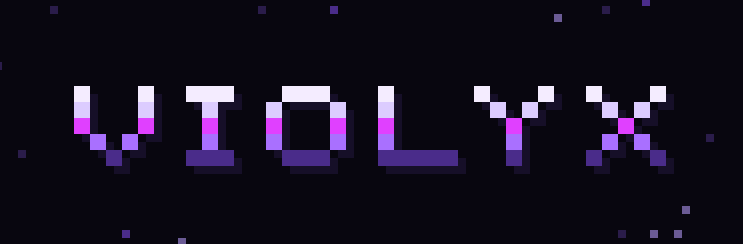
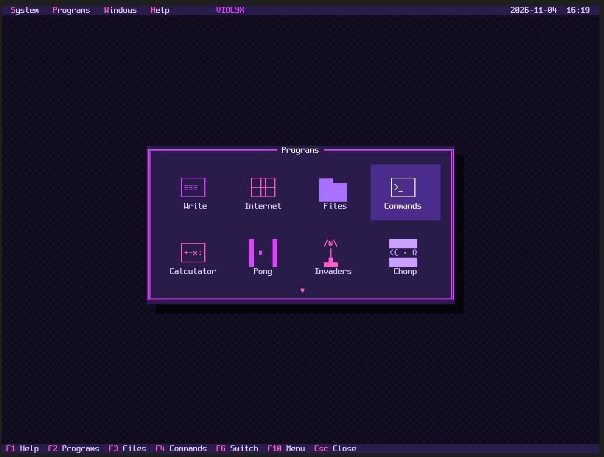
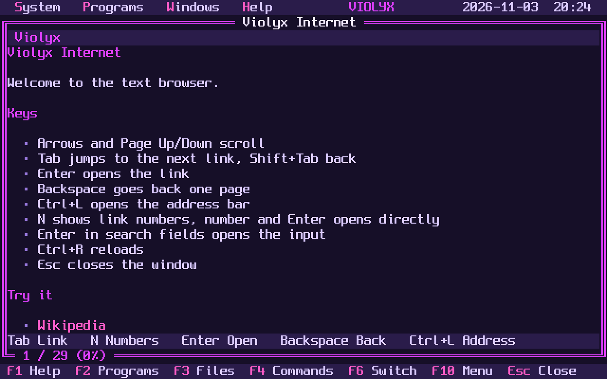

# Violyx

**A keyboard-only 64-bit operating system for x86 PCs, with a retro text desktop in glowing violet.**

Violyx is written from scratch: its own kernel, drivers, file system, windowed text
desktop and programs. There is no Linux underneath. It boots on BIOS and UEFI, connects
to the internet and browses the web in a text browser, all without ever touching a mouse.



| | |
|---|---|
|  |  |

> **Status: experimental hobby project (version 0.1.1).** Tested in QEMU and VirtualBox,
> not yet on real hardware. Violyx has no memory protection, so please do not enter
> passwords or use it for anything sensitive. See [Limitations](#limitations).

## Features

- **Keyboard-only desktop** with overlapping windows, menus and dialogs
- **Text browser** with HTTPS, certificate checks, links, search forms and link numbers
- **Programs:** Write, Files, Commands, Calculator, Calendar, Settings
- **Games:** Pong, Invaders, Chomp and Mines
- **Networking:** Intel E1000 driver, DHCP, DNS, ping, TCP/IP via lwIP
- **HTTPS:** TLS 1.2 and 1.3 via Mbed TLS with Mozilla root certificates
- **Storage:** IDE, AHCI (SATA), NVMe and USB mass storage
- **File system:** VioFS 2 with folders, long file names and large files
- **USB sticks:** read and write FAT32 sticks under `/drives`, with hot-plugging and a safety prompt
- **USB keyboards** on xHCI controllers, plus PS/2
- **Installer** with several safety prompts
- **Two languages:** English and German, with US and German keyboard layouts
- **Boots on BIOS and UEFI** through the Limine bootloader

## Try it

Download `violyx.iso` or another image from the [Releases](../../releases) page.

### QEMU

```sh
qemu-system-x86_64 -drive file=violyx.img,format=raw -m 512 -nic user,model=e1000
```

For UEFI, also pass your QEMU firmware file:

```sh
qemu-system-x86_64 -drive if=pflash,format=raw,readonly=on,file=edk2-x86_64-code.fd \
  -drive file=violyx.img,format=raw -m 512 -nic user,model=e1000
```

### VirtualBox

1. Create a VM with type **Other** and version **Other/Unknown (64-bit)**. The 64-bit
   version matters: Violyx does not run on the 32-bit setting.
2. Give it at least **512 MB** of memory.
3. Attach `violyx.vdi` as an existing hard disk, or use `violyx.iso` to try Violyx
   without saving.
4. Set the network adapter type to **Intel PRO/1000 MT Desktop**.
5. Optional: enable EFI to boot through UEFI.

### USB stick

Write `violyx.img` to a stick, for example with Rufus in DD mode. This erases the
stick. Secure Boot must be turned off because Violyx is not signed.

## Keyboard

| Key | Action |
|---|---|
| F1 | Help |
| F2 | Programs overview |
| F3 / F4 | Files / Commands |
| F5 / F6 | Zoom / switch window |
| F7 | Internet |
| F9 | Calculator |
| F10 | Menu |
| Alt+S, P, W, H | Open a menu directly |
| Esc | Close the window |
| Ctrl+Arrows / Shift+Arrows | Move / resize the window |

In the browser: Tab selects links, Enter opens them, Backspace goes back, Ctrl+L opens
the address bar. Press N to show link numbers, then type a number and Enter. Ctrl+S
saves the page to `/downloads`.

In Files: Enter opens, Backspace goes up, N creates a file, O creates a folder, C
copies, R renames or moves, Del deletes. In `/drives`, E ejects a drive.

In Calendar: arrows pick a day, Page Up/Down change the month, T jumps to today, Enter
adds a note and Del removes it. Notes are saved in `/system/calendar`.

The Programs menu lists the overview and all open windows, so you can jump to any of them.

In Commands: `dir`, `cd`, `pwd`, `mkdir`, `del`, `mv`, `cp`, `type`, `edit`, `df`, `eject`.

## USB drives

Plug in a FAT32 stick and it appears in the `/drives` folder as `usb1`, `usb2` and so on.
Violyx reads nothing from a stick until you allow it: the first time you open a drive it
asks for confirmation. Answer `Y` or `J` to read and save files there. Only USB drives are
listed, never internal disks. Use **E** in Files or `eject` in Commands before unplugging.

Sticks can be plugged in while Violyx is running, and the live ISO can save to them too.
Files use long names and are compatible with Windows, macOS and Linux. exFAT and NTFS are
not supported.

## Games

Open them from the Programs overview (F2) or the Programs menu. Esc closes a game.

| Game | Goal | Keys |
|---|---|---|
| Invaders | Stop the alien waves | Arrows move, Space fires, P pauses |
| Chomp | Eat all dots and avoid the ghosts | Arrows or WASD move, P pauses |
| Mines | Uncover every safe field | Arrows move, Space opens, F flags, 1 to 3 size, N new game |

## Language and keyboard layout

Violyx starts in English with a US keyboard layout. Change both under
**System → Settings**. The choice takes effect immediately, is saved, and carries over
into an installation.

## Installing

Start Violyx from the ISO or a USB stick and open **System → Install**.

**Violyx always uses the entire disk and erases everything on it.** The default answer
is always No, and you must type `DELETE` to continue. Installing into a single partition
next to another system is not supported yet. Please check the disk model carefully.

## Build from source

You need Linux with `gcc`, `nasm`, `make`, `binutils` and `python3`.

```sh
make
```

The results are in `build/`: `violyx.img`, `violyx.iso` and `violyx.vdi`.

## Project layout

| Path | Contents |
|---|---|
| `kernel/main.c`, `entry.asm` | Startup, interrupts, memory, timers, clock |
| `kernel/ui.c` | Graphics output, windows, menus, dialogs |
| `kernel/apps.c`, `browser.c`, `calendar.c` | Programs, text browser and calendar |
| `kernel/games.c` | Invaders, Chomp and Mines, game logic also testable on a host system |
| `kernel/html.c` | HTML layout, also testable on a host system |
| `kernel/kbd.c`, `xhci.c` | Keyboard layouts, USB |
| `kernel/viofs.c` | VioFS 2 file system, also testable on a host system |
| `kernel/fat.c`, `drives.c` | FAT32 driver and the `/drives` layer with its access prompt |
| `kernel/disk.c`, `ahci.c`, `nvme.c` | Block layer, IDE, storage drivers |
| `kernel/net.c`, `tls.c`, `http.c` | Network driver, TLS, HTTP |
| `kernel/install.c`, `acpi.c` | Installer, power off |
| `tools/` | Image builders and test tools |
| `third_party/` | Bundled components |

## Limitations

- No memory protection or separate processes: a bug can bring down the whole system.
- Browser: no JavaScript, images, cookies or password fields. Many modern sites will not work.
- Network: Intel E1000 cards only, no Wi-Fi.
- USB: xHCI (USB 3 controllers) only, no hubs. A stick on an external hub is not detected.
- FAT32: one partition per stick, 512-byte sectors, files up to 4 GB. Writing is slow because data is sent sector by sector. Pulling a stick while writing can lose that file and leave unused space behind, but the tested write order keeps other files intact.
- File system: no journal. A power failure can lose free space, but the tested write order keeps existing data intact. There is no repair tool yet.
- Files in Write are limited to 1 MB.
- Upgrading from older disks requires a reinstall.
- NVMe and USB storage: 512-byte sectors only.
- Root certificates only update with new Violyx releases. Certificate revocation is not checked.

## License

Violyx is released under the [MIT License](LICENSE). Bundled components keep their own
licenses, listed in [THIRD-PARTY-NOTICES.md](THIRD-PARTY-NOTICES.md).

## Deutsch

Violyx ist ein eigenes 64-Bit-Betriebssystem für x86-PCs, das komplett per Tastatur
bedient wird. Es hat einen Retro-Textdesktop in leuchtendem Violett, einen Textbrowser
mit HTTPS und läuft ohne Linux-Unterbau.

Violyx startet auf Englisch mit US-Tastatur. Unter **System → Settings** stellst du
**Language** auf Deutsch und **Keyboard** auf das deutsche Layout um. Beides bleibt
gespeichert.

FAT32-USB-Sticks erscheinen im Ordner `/drives`. Beim ersten Öffnen fragt Violyx nach,
erst nach `J` oder `Y` kannst du dort lesen und speichern.

Violyx ist ein experimentelles Hobbyprojekt und bisher nur in QEMU und VirtualBox
getestet. Es hat keinen Speicherschutz, gib daher keine Passwörter ein. Der Installer
löscht die gesamte gewählte Platte.
